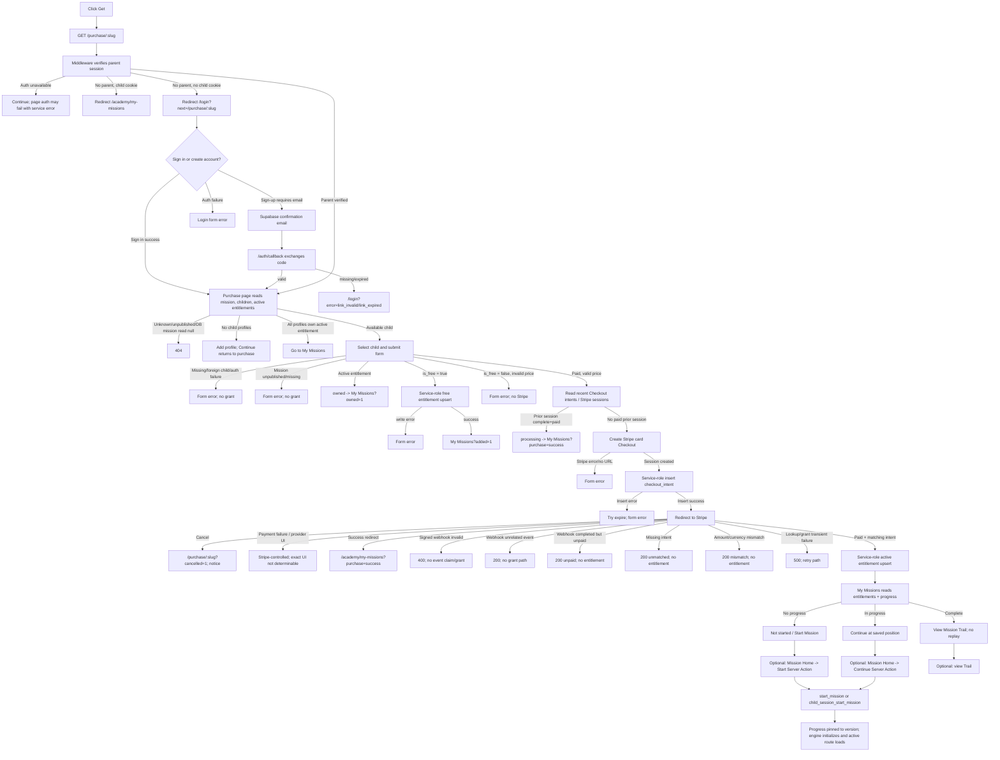

# Get Mission: end-to-end flow

> Code-traced on 2026-10-13. This document describes the current repository
> implementation; deployed Supabase, Stripe, and email-provider configuration
> can differ from the code.

## Contents

- [Overview](#overview)
- [Step-by-step flow](#step-by-step-flow)
- [Functions and endpoints](#functions-and-endpoints)
- [Database interaction and access control](#database-interaction-and-access-control)
- [Scenario matrix](#scenario-matrix)
- [Authentication and middleware](#authentication-and-middleware)
- [Client state and visible messages](#client-state-and-visible-messages)
- [External services and webhooks](#external-services-and-webhooks)
- [Diagrams](#diagrams)
- [Gaps, risks, and not determinable items](#gaps-risks-and-not-determinable-items)

## Overview

The "Get mission" control on the public mission detail route is a styled
navigation link, not a form submission or mutation. It sends the browser to
`/purchase/<mission.slug>`. The purchase page requires a parent account,
selects which child should receive access, and then grants a free mission
immediately or creates a Stripe Checkout session for a paid mission. Paid
access is granted only by the signed Stripe webhook after it verifies the
completed payment and its stored checkout intent. The application then shows
the child's mission in My Missions, where the learner can open Mission Home.

- The route component is `MissionDetailPage`, in
  `src/app/(public)/missions/[slug]/page.tsx:37`; it renders the link at line
  127 with `href={`/purchase/${mission.slug}`}` at line 128.
- The shared link wrapper is `ButtonLink` in `src/components/ui/button.tsx:128`.
  It renders Next.js `<Link>` (`:141`), so there is no button click handler,
  `onClick`, loading state, or submit action on this public CTA.
- Its visible label is always `Get {mission.title}`. If the published mission
  row yielded a formatted price, ` — {priceLabel}` is appended
  (`src/app/(public)/missions/[slug]/page.tsx:132`). The title comes from the
  static public catalogue; price and duration are fetched from Supabase.
- The link itself has no state for sign-in, ownership, free/paid status, or
  mission progress. It remains "Get …" even if a parent or child already has
  the mission. A visitor with an unlisted public slug sees a 404 before the
  link can render (`src/app/(public)/missions/[slug]/page.tsx:42-44`).
- On `/purchase/<slug>`, the form has three outcomes:
  - No child profiles: text "Add a child profile first — missions belong to a
    child, not to the account." and an "Add a profile" link.
  - Every child already has active access: text "Everyone on this account
    already has {missionTitle}." and "Go to My Missions".
  - At least one child is available: one required radio selection and a submit
    button. It reads "Add this mission" for free missions, or
    "Continue to payment — {priceLabel}" for paid ones. While pending, the
    button is disabled and reads "Adding mission…" or "Taking you to payment…"
    respectively (`src/components/commerce/purchase-form.tsx:35-116`).
- The button label/action on Mission Home after access is status-driven:
  "Start Mission", "Continue Mission", or "View Mission" in the My Missions
  card; Mission Home uses "Start Mission →"/"Continue Mission →", or, if
  complete, "View Mission Trail →"
  (`src/components/academy/mission-collection.tsx:43-47`,
  `src/app/(academy)/academy/missions/[missionId]/page.tsx:95-151`).

## Step-by-step flow

### A. Public detail page and click

1. Next.js renders `MissionDetailPage` with a route `slug`. It looks the slug
   up in the static catalogue using `findPublicMission`. A catalogue miss calls
   `notFound()`; a match supplies the title, copy, age band, and other public
   presentation data (`src/app/(public)/missions/[slug]/page.tsx:37-44`;
   `src/features/public-site/catalogue.ts`).
2. The page calls `getPublicMissionFacts(mission.slug)`. This uses the
   request-cookie-bound Supabase server client and selects
   `duration, price_minor, currency, is_free` from `missions`, filtering by
   `slug` and `published = true` (`src/features/public-site/queries.ts:23-43`).
   The query error is logged and rendered as no facts; a row with no price,
   free status, or no published row has no displayed price. The function also
   `console.log`s the returned row (`:33-38`).
3. The server output contains a Next `<Link>` styled as a large primary action.
   Clicking it navigates to `/purchase/<slug>`. No purchase, entitlement, or
   progress write occurs on this page. Next.js may prefetch route data under
   its normal `<Link>` behavior; whether/how much is prefetched in a particular
   deployment is **NOT DETERMINABLE FROM CODE**. The purchase route itself does
   not perform a write during its render.

### B. Middleware and parent sign-in gate

4. `src/middleware.ts:4-5` calls `updateSession` for all routes except the
   static asset exclusions in its matcher (`src/middleware.ts:8-15`).
   `updateSession` creates an auth-middleware Supabase client, calls
   `auth.getUser()` to validate/refresh the session, and updates cookies
   (`src/lib/supabase/middleware.ts:39-75`).
5. `/purchase` is a parent-only prefix. If no parent user is verified:
   - With a child-session cookie present, middleware redirects to
     `/academy/my-missions` and removes query parameters. It does not send that
     child to parent sign-in (`src/lib/supabase/middleware.ts:10-12, 87-101`).
   - Without that cookie, it redirects to `/login?next=/purchase/<slug>`
     (`:94-101`). Middleware stores the pathname, not the original query.
   - If auth verification is unavailable (undefined/zero/5xx status), it does
     not guess that the user is signed out; it lets the request continue
     (`:76-80`). The route's `requireParent` then throws
     `ServiceUnavailableError` for an unavailable auth service
     (`src/lib/permissions/index.ts:105-124`).
6. The login page shows the notice "Sign in or create an account to get this
   mission. We'll bring you straight back to it." when `next` starts with
   `/purchase/` (`src/app/(auth)/login/page.tsx:12-41`). The sign-in form
   posts email, password, and hidden `next` to `signInAction`; its submit label
   changes from "Sign in" to "Signing in…" while pending
   (`src/components/auth/sign-in-form.tsx:9-59`).
7. `signInAction` validates with `signInSchema`, calls
   `supabase.auth.signInWithPassword`, returns field/form errors for failure,
   and redirects to `safeNext(next)` on success
   (`src/features/auth/actions.ts:103-140`). For this route, the intended
   destination is the same `/purchase/<slug>`.
8. If the visitor chooses "Create one", `SignInForm` links to
   `/signup?next=<encoded destination>` (`src/components/auth/sign-in-form.tsx:53-57`).
   `signUpAction` validates submitted details, passes the safe destination
   through the Supabase sign-up confirmation URL, and either:
   - returns "Check your email to confirm your account, then sign in." when
     Supabase returns no session, or
   - redirects directly to the destination when it returns a session
     (`src/features/auth/actions.ts:39-100`).
9. For email confirmation, Supabase must send a valid confirmation link to
   `/auth/callback?next=<destination>`. The callback requires a `code`,
   exchanges it with `auth.exchangeCodeForSession`, and redirects to the safe
   destination. Missing/invalid/expired links redirect to
   `/login?error=link_invalid` or `/login?error=link_expired`
   (`src/app/auth/callback/route.ts:10-30`). The Auth email URL/template and
   confirmation setting are external Supabase configuration.

### C. Purchase page and child selection

10. `/purchase/[slug]` renders `PurchasePage`
    (`src/app/purchase/[slug]/page.tsx:25-84`). `getPurchasableMission` first
    calls `requireParent`, then queries `missions` for the slug with
    `published = true` (`src/features/commerce/queries.ts:12-23`). Missing,
    unpublished, or failed reads produce `null` here; the page calls
    `notFound()`.
11. In parallel, the page calls:
    - `listChildren()`: `child_profiles` rows for the authenticated parent,
      ordered by `created_at` (`src/features/children/queries.ts:15-27`).
    - `getEntitledChildIds(mission.id)`: active entitlement child IDs for this
      mission (`src/features/commerce/queries.ts:33-45`).
12. The mission title, Lab, age range and duration are displayed. Price is
    formatted from `price_minor` and the mission's own `currency`. If there
    are no child profiles, the page instead offers `/account/children/new?next=…`.
    `NewChildPage` passes that safe `next` through to `NewChildForm`
    (`src/app/account/children/new/page.tsx:6-20`;
    `src/components/commerce/purchase-form.tsx:40-55`).
13. Creating a profile is a separate parent action, not part of the Get link:
    `createChildAction` validates name/year, calls `requireParent`, inserts a
    `child_profiles` row with `parent_id` from the verified session (never
    from the form), revalidates Account and Academy layouts, and returns the
    safe `next` (`src/features/children/actions.ts:67-125`). The optional
    access-code issue happens after the child insert; it is not needed to buy.
    The confirmation screen's "Continue" link returns to `/purchase/<slug>`
    (`src/components/profile/child-form.tsx:111-205`).
14. If all children have an active entitlement, the form does not render; the
    user sees "Everyone on this account already has …" and can navigate to
    My Missions. If some children do not have active access, only those child
    profiles are offered; the first is initially selected (`src/components/commerce/purchase-form.tsx:38-102`).

### D. Purchase form action and server authorization

15. `PurchaseForm` binds the route mission slug to
    `acquireMissionAction`, then passes that action to React `useActionState`
    (`src/components/commerce/purchase-form.tsx:35-36`). Submitting the form
    sends `childId` from the required radio input. Pending is local React
    state; there is no optimistic entitlement update.
16. The Next Server Action `acquireMissionAction` rejects a missing `childId`
    with "Choose who this mission is for." It invokes `acquireMission` with
    the bound slug, child ID and origin derived from forwarded-host/host and
    protocol headers (`src/features/commerce/actions.ts:29-47, 86-91`).
17. `acquireMission` authorizes in order:
    1. `requireParent()` uses the cookie-bound server client and
       `auth.getUser()`. An unauthenticated session throws `AccessError`.
    2. `requireOwnedChild(childId)` re-queries `child_profiles` with both
       `id = submitted childId` and `parent_id = verified user.id`; it does not
       trust the browser's child ID.
    3. It reads a published mission by `slug`.
    4. It reads an active entitlement for this child+mission.
       (`src/features/commerce/checkout.ts:63-104`,
       `src/lib/permissions/index.ts:105-157`).
18. An authorization `AccessError` returns the generic form error
    "Choose who this mission is for." A `CheckoutError` returns its message.
    An unclassified error is logged and returns
    "We couldn't add that mission. Please try again.--tmr"
    (`src/features/commerce/actions.ts:48-56`).

### E. Acquisition: active, free, and paid

19. If an active entitlement was found, acquisition returns `owned` without a
    payment or write. The action attempts to set this child as the active
    child, revalidates `/academy` layout, then redirects to
    `/academy/my-missions?owned=1` (`src/features/commerce/checkout.ts:95-100`;
    `src/features/commerce/actions.ts:59-74`). The active-child write is
    ownership-checked but its error is swallowed; see [Gaps and risks](#gaps-risks-and-not-determinable-items).
20. If `mission.is_free` is true, it skips Stripe and the prior-checkout scan.
    `grantFreeEntitlement` uses the service-role client to upsert
    `{child_id, mission_id, source:"free", status:"active"}` on conflict
    `(child_id, mission_id)` with `ignoreDuplicates: true`
    (`src/features/commerce/checkout.ts:103-110, 186-207`). A write error
    throws "We couldn't add that mission. Please try again." On success it
    returns `granted`; the action sets active child, revalidates Academy and
    redirects to `/academy/my-missions?added=1` (`src/features/commerce/actions.ts:69-72`).
21. For a non-free mission, `settlePriorCheckouts` queries up to five intents
    from the last 24 hours for this child+mission, newest first. It retrieves
    each Stripe session. If one is complete and paid it returns `processing`;
    if one is open it attempts to expire it. Per-session Stripe errors are
    caught and ignored, leaving the session unresolved
    (`src/features/commerce/checkout.ts:114-117, 144-176`).
22. `processing` does not create another Checkout. The action sets active
    child, revalidates Academy, and redirects to
    `/academy/my-missions?purchase=success` (`src/features/commerce/actions.ts:75-79`).
23. Otherwise `createCheckoutSession` validates a positive `price_minor`;
    `is_free = false` with null/zero/negative price is rejected with
    "That mission isn't available to buy right now." It asks Stripe to create
    a payment-mode session with:
    - one line item, quantity 1, server-read `price_minor` and lowercased
      mission currency;
    - `payment_method_types: ["card"]`;
    - optional mission description and parent email;
    - success URL `/academy/my-missions?purchase=success`;
    - cancel URL `/purchase/<slug>?cancelled=1`;
    - metadata with child, mission, and parent IDs (convenience only; webhook
      does not trust it).
    (`src/features/commerce/checkout.ts:217-287`).
24. Stripe API errors during creation are logged and returned to the form as
    "We couldn't start the payment. Please try again." A missing Stripe
    `session.url` returns "We couldn't start the payment."
    (`src/features/commerce/checkout.ts:248-311`).
25. Before redirecting to Stripe, the server-role client inserts the
    `checkout_intents` row with Stripe session ID, parent, child, mission,
    amount and currency. If it fails, it logs the error, tries to expire the
    new session, and returns "We couldn't start the payment. Please try
    again." If it succeeds, the Server Action redirects to the Stripe session
    URL (`src/features/commerce/checkout.ts:312-347`;
    `src/features/commerce/actions.ts:83`).

### F. Stripe, webhook, and confirmation

26. The user enters payment details on Stripe Checkout. The application
    configures card payments only. The exact UI, authorization, issuer declines,
    wallet availability, settlement and timing are controlled by Stripe and
    are **NOT DETERMINABLE FROM CODE**.
27. On cancellation, Stripe is configured to return to
    `/purchase/<slug>?cancelled=1`. `PurchasePage` shows
    "Payment cancelled. Nothing has been charged."
    (`src/app/purchase/[slug]/page.tsx:65-69`). There is no app cancellation
    handler or intent deletion. Whether Stripe has already expired/canceled
    that session is **NOT DETERMINABLE FROM CODE**.
28. The success URL is a normal redirect to `/academy/my-missions?purchase=success`.
    It is not a signed payment result and has no Checkout-session ID
    placeholder. My Missions shows
    "Thank you. Once the payment is confirmed, this mission will appear here."
    whenever that query parameter is present
    (`src/features/commerce/checkout.ts:275`;
    `src/app/(academy)/academy/my-missions/page.tsx:127-130`). The page does
    not wait, poll, or query Stripe to establish payment.
29. Separately, Stripe sends an HTTP `POST` to
    `/api/webhooks/stripe`. The route validates `stripe-signature` against the
    raw body and `STRIPE_WEBHOOK_SECRET`; invalid/missing signatures return
    400. It inserts the Stripe event ID/type in `stripe_events` as an
    idempotency claim. Only a unique violation counts as a duplicate; other
    claim failures return 500. Non-`checkout.session.completed` event types
    return 200 without acquisition work
    (`src/app/api/webhooks/stripe/route.ts:45-100`).
30. For `checkout.session.completed`, it requires `payment_status === "paid"`;
    unpaid sessions return 200 without entitlement. It then looks up
    `checkout_intents` by Stripe session ID. Lookup errors log and return 500
    (releasing the claim best-effort for first delivery); a missing intent logs
    `stripe_no_checkout_intent` and returns 200 unmatched. Amount and
    uppercased currency must match the stored intent; mismatch logs and
    returns 200 without granting
    (`src/app/api/webhooks/stripe/route.ts:95-164`).
31. If all checks pass, the webhook service-role upserts
    `mission_entitlements` as `{child_id, mission_id, source:"purchase",
    status:"active", stripe_payment_intent_id}` with conflict ignore. A
    database error logs `stripe_entitlement_failed`, attempts claim release,
    and returns 500 so Stripe may retry (`src/app/api/webhooks/stripe/route.ts:167-190`).
32. On a newly inserted entitlement, it reads the child, mission, and parent
    email using service role, then attempts a confirmation email. Email errors
    do not undo the entitlement or fail the webhook; no email is sent if the
    provider variables are absent (`src/app/api/webhooks/stripe/route.ts:193-205, 264-305`;
    `src/lib/email/send.ts:43-84`).
33. When the user loads My Missions, parent actor flow reads active
    entitlements joined to `missions(*)` and the child's progress rows. An
    entitlement with no progress row appears as "Not started"; the status
    determines the card action. The paid mission appears only once the webhook
    has committed an active entitlement
    (`src/features/missions/queries.ts:31-57`;
    `src/app/(academy)/academy/my-missions/page.tsx:97-105`).

### G. Optional next step: opening and starting the mission

The Get link's own flow ends on Purchase, Stripe, or My Missions. It does not
start progress. For context on the requested progress/version scenarios:

34. The collection card links to `/academy/missions/<slug>`. The actor is
    resolved (child session takes priority when present; otherwise authenticated
    parent and active child). `getMissionHomeFor` loads Mission Home only after
    the entitlement check (`src/features/academy/actor.ts:25-75`;
    `src/features/academy/collection.ts:83-110`).
35. On the parent path, `getMissionHome` checks ownership, mission existence,
    active entitlement and progress, then calls
    `effective_mission_version(p_child_id, p_mission_id)`, and reads that
    version's `mission_resources` and `mission_parent_notes`
    (`src/lib/permissions/index.ts:161-225`;
    `src/features/missions/queries.ts:173-218`). On a child-session path,
    `child_session_mission` is called with the token; the database derives the
    child and checks entitlement. A missing mission/entitlement results in a
    404, not a mission experience.
36. Status controls the action: no progress / `not_started` -> Start; active
    run -> Continue at server-persisted position; `complete` -> View Mission
    Trail (not replay). Start/Continue use `StartMissionButton` and
    `startMissionAction`; the button becomes disabled with "Starting mission…"
    while pending (`src/components/mission/start-mission-button.tsx:1-44`;
    `src/features/mission-engine/actions.ts:24-48`).
37. `startVia` authorizes again. For parent sessions its gateway calls RPC
    `start_mission(p_child_id, p_mission_id)`; for a child session it calls
    `child_session_start_mission(p_token, p_mission_id)`. The DB function
    checks child ownership and active entitlement, reads the current
    `missions.version` and completion rule, selects the first screen for that
    version, upserts `mission_progress` and inserts an empty
    `mission_state` row. Conflict handling avoids resetting existing position,
    status, or pinned version (`src/features/mission-engine/persistence.ts:112-139, 174-203`;
    `supabase/migrations/20260925220700_start_mission_access.sql:24-102`).
38. `startVia` then loads/initializes the run through the mission-engine store.
    The store calls service-role-only `engine_load_run` and `engine_save`;
    initialization writes public/private state and an analytics `mission_started`
    event as part of the save transaction. The action revalidates mission and
    collection paths and redirects to `/academy/missions/<slug>/active`
    (`src/features/mission-engine/persistence.ts:174-203`;
    `src/features/mission-engine/store.ts:33-95`;
    `supabase/migrations/20261004100000_engine_foundation.sql:263-298, 300-416`;
    `src/features/mission-engine/actions.ts:35-48`).
39. Later interactions are separate Server Actions and use the pure runtime,
    then `store.saveRun`/`engine_save`; they are not triggered by the Get link.
    The current screen is projected to the browser and mission state remains
    server-authoritative (`src/features/mission-engine/actions.ts:53-132`;
    `src/features/mission-engine/store.ts:57-95`).

## Functions and endpoints

For Supabase PostgREST paths below, `<ref>` is a placeholder for the deployed
Supabase project reference. No keys or real project references are included.
Functions called inside a Server Component/action run in the application
process; they are not separate HTTP endpoints unless the row describes the
resulting Server Action, route handler, or provider call.

| Name | Type | Method and path / URL pattern | Request payload / inputs | Response shape / outcome | Client | Definition |
|---|---|---|---|---|---|---|
| Public mission detail | Next.js page | `GET /missions/:slug` | Route param `slug` | Rendered page or 404 | Server Component; request-bound Supabase client for facts | `src/app/(public)/missions/[slug]/page.tsx:37` |
| `ButtonLink` navigation | Next.js link | Browser navigation to `GET /purchase/:slug` | `href` from static catalogue slug; no body | Purchase page, auth redirect, or 404 | Browser / Next `<Link>` | `src/components/ui/button.tsx:128-151` |
| `updateSession` | Middleware | Middleware on matching request; auth request below | Request cookies | `NextResponse.next` with refreshed cookies or redirect | Auth-middleware client (publishable/anon key + request cookies) | `src/middleware.ts:4-15`; `src/lib/supabase/middleware.ts:39-117` |
| Supabase `auth.getUser` | Supabase Auth API | `GET https://<ref>.supabase.co/auth/v1/user` (SDK operation) | Auth cookies/access token | Verified user or auth error | Auth-middleware client, then request-bound SSR client | `src/lib/supabase/middleware.ts:39-75`; `src/lib/permissions/index.ts:105-124` |
| `getPublicMissionFacts` | Server function / PostgREST | `GET https://<ref>.supabase.co/rest/v1/missions?select=duration,price_minor,currency,is_free&slug=eq.<slug>&published=eq.true` | Slug; `maybeSingle` | `{data: facts|null, error}`; failures logged and display no facts | Request-bound SSR client, publishable/anon key + cookies | `src/features/public-site/queries.ts:23-43` |
| `PurchasePage` + `getPurchasableMission` | Server Component + server function | `GET /purchase/:slug`; PostgREST `GET /rest/v1/missions?select=*&slug=eq.<slug>&published=eq.true` | Slug | Purchase HTML or `notFound()` | Request-bound SSR client | `src/app/purchase/[slug]/page.tsx:25-84`; `src/features/commerce/queries.ts:12-23` |
| `listChildren` | Server function / PostgREST | `GET https://<ref>.supabase.co/rest/v1/child_profiles?select=*&parent_id=eq.<user-id>&order=created_at.asc` | Verified parent user ID from `requireParent` | Child rows ordered oldest first; `data ?? []` | Request-bound SSR client | `src/features/children/queries.ts:15-27` |
| `getEntitledChildIds` | Server function / PostgREST | `GET https://<ref>.supabase.co/rest/v1/mission_entitlements?select=child_id&mission_id=eq.<id>&status=eq.active` | Mission UUID | Active entitled child IDs; `data ?? []` | Request-bound SSR client | `src/features/commerce/queries.ts:33-45` |
| `acquireMissionAction` | Next Server Action | Framework-generated `POST` for current form action (no stable public URL) | Bound `missionSlug`; FormData `childId` | Form state `{error?}` or redirect to My Missions / Stripe URL | Server action; internally request-bound SSR + service-role clients | `src/features/commerce/actions.ts:29-83` |
| `requireParent` / `requireOwnedChild` | Server authorization functions | No independent HTTP route; Auth + PostgREST requests | Session cookies; child ID | `{user,supabase}` and verified child, or `AccessError` / `ServiceUnavailableError` | Request-bound SSR client | `src/lib/permissions/index.ts:105-157` |
| Acquisition mission + entitlement checks | Server function / PostgREST | `GET /rest/v1/missions?select=*&slug=eq.<slug>&published=eq.true`; `GET /rest/v1/mission_entitlements?select=id&child_id=eq.<child>&mission_id=eq.<mission>&status=eq.active` | Mission slug, verified child | Mission row / active entitlement or no row | Request-bound SSR client | `src/features/commerce/checkout.ts:63-104` |
| `settlePriorCheckouts` intent lookup | Server function / PostgREST | `GET /rest/v1/checkout_intents?select=stripe_session_id&child_id=eq.<child>&mission_id=eq.<mission>&created_at=gte.<24h>&order=created_at.desc&limit=5` | Child, mission, lower time bound | Recent session IDs; each retrieved from Stripe | Request-bound SSR client | `src/features/commerce/checkout.ts:144-176` |
| Stripe prior-session status / expire | External Stripe API (Stripe SDK) | `GET /v1/checkout/sessions/:id`; possibly `POST /v1/checkout/sessions/:id/expire` | Session ID | Session status/payment status; expire attempt | Stripe SDK with server secret | `src/features/commerce/checkout.ts:160-171` |
| `grantFreeEntitlement` | Server function / PostgREST | `POST /rest/v1/mission_entitlements?on_conflict=child_id,mission_id` with upsert | Child ID, mission ID, source `free`, status `active`; ignore duplicates | Selected upsert result/error; error becomes CheckoutError | Service-role Supabase client; bypasses RLS | `src/features/commerce/checkout.ts:186-207` |
| Stripe Checkout creation | External Stripe API (Stripe SDK) | `POST https://api.stripe.com/v1/checkout/sessions` | mode payment; one card line item; amount in minor units; lowercase currency; success/cancel URLs; metadata | Stripe Checkout Session; app requires `session.url` | Stripe SDK with server secret | `src/features/commerce/checkout.ts:217-311` |
| Checkout intent write | Server function / PostgREST | `POST /rest/v1/checkout_intents` | `stripe_session_id,parent_id,child_id,mission_id,amount_minor,currency` | Insert error or success; on error best-effort expire session | Service-role Supabase client; bypasses RLS | `src/features/commerce/checkout.ts:312-345` |
| Stripe-hosted Checkout | External hosted page | Stripe-provided session URL | Card data handled by Stripe; no card data in this application code | Stripe redirects to configured success/cancel URL | Stripe | Created at `src/features/commerce/checkout.ts:248-287`; UI/details external |
| Stripe webhook | Next API route | `POST /api/webhooks/stripe` | Raw Stripe event body + `stripe-signature` header | JSON 400 invalid signature; 500 retryable errors; otherwise 200 JSON received/unpaid/unmatched/mismatch/duplicate | Route uses Stripe SDK and service-role Supabase client | `src/app/api/webhooks/stripe/route.ts:45-215` |
| Webhook event claim | Server function / PostgREST | `POST /rest/v1/stripe_events` | Stripe event ID and type | Insert success; `23505` duplicate; other DB error 500 | Service-role Supabase client | `src/app/api/webhooks/stripe/route.ts:70-93` |
| Webhook intent lookup | Server function / PostgREST | `GET /rest/v1/checkout_intents?select=child_id,mission_id,amount_minor,currency&stripe_session_id=eq.<id>` | Stripe Checkout session ID | Intent row, null, or error | Service-role Supabase client | `src/app/api/webhooks/stripe/route.ts:107-137` |
| Webhook entitlement grant | Server function / PostgREST | `POST /rest/v1/mission_entitlements?on_conflict=child_id,mission_id` with upsert | Child, mission, `source:"purchase"`, `status:"active"`, payment intent ID | Inserted row ID or duplicate/no returned row; error 500 | Service-role Supabase client | `src/app/api/webhooks/stripe/route.ts:163-190` |
| Access confirmation lookup | Server function / PostgREST | `GET /rest/v1/child_profiles?select=display_name,parent_id&id=eq.…`; `GET /rest/v1/missions?select=title,slug&id=eq.…`; then `GET /rest/v1/profiles?select=email&id=eq.…` | Child and mission IDs; parent ID from child | Child, mission, parent email or no email; failures are swallowed/logged | Service-role Supabase client | `src/app/api/webhooks/stripe/route.ts:264-305` |
| Purchase confirmation email | External API | `POST https://api.resend.com/emails` | Sender, recipient parent, mission/child subject and text/link | HTTP response; failures logged and swallowed | Resend via server `fetch`; API key held server-side | `src/lib/email/send.ts:43-84` |
| My Missions data load | Server function / PostgREST | `GET /rest/v1/mission_entitlements?select=mission_id,missions(*)&child_id=eq.…&status=eq.active`; `GET /rest/v1/mission_progress?select=mission_id,status,last_activity_at&child_id=eq.…` | Resolved child ID | Collection with status from progress or default `not_started` | Request-bound SSR client (parent); child route instead uses RPC | `src/features/missions/queries.ts:31-57` |
| Child My Missions alternative | Supabase RPC | `POST https://<ref>.supabase.co/rest/v1/rpc/child_session_missions` | `{p_token}` | Entitled missions and progress for token-derived child | Child-session publishable client; child ID not supplied | `src/features/academy/collection.ts:20-75`; migration `supabase/migrations/20260929100100_child_access.sql:427-465` |
| Sign in / sign up / email callback (only when needed) | Next Server Actions / route + Supabase Auth | Server Action `POST` (framework-generated); callback `GET /auth/callback?code=…&next=…`; Auth SDK calls GoTrue | Sign-in email/password; sign-up identity; confirmation code | Form errors/notices or redirect; callback creates session | Request-bound SSR client | `src/features/auth/actions.ts:39-140`; `src/app/auth/callback/route.ts:10-30` |
| Add child (only when parent has no profiles) | Next Server Action / PostgREST | Server Action `POST`; `POST /rest/v1/child_profiles` | Display name, optional birth year; parent ID derived from verified user | Created child profile or exact form error; Continue link returns to purchase | Request-bound SSR client | `src/features/children/actions.ts:67-125`; `src/components/profile/child-form.tsx:111-205` |
| Start mission (only after user opens Mission Home) | Next Server Action + Supabase RPC | Server Action `POST`; `POST /rest/v1/rpc/start_mission` for parent, or `child_session_start_mission` for child | Parent path: child+mission UUID; child path: token+mission UUID | Progress row; redirect to active mission | Request-bound SSR client via authorized parent gateway; token-scoped client for child | `src/features/mission-engine/actions.ts:24-48`; `src/features/mission-engine/persistence.ts:112-139` |

## Database interaction and access control

### Reads and writes caused by the Get / purchase / confirmation flow

The list below includes render-time public facts, purchase-page reads,
acquisition, webhook processing, and the My Missions collection read. It does
not imply that all rows exist on every path.

The traced checkout flow uses `mission_entitlements`; it does not read or
write `mission_access`. The checked-in generated snapshot
`src/types/database.types.ts:669-706` contains a `mission_access` type, but no
SQL migration in this repository defines that table. Whether the deployed
database still has a legacy `mission_access` table is **NOT DETERMINABLE FROM
CODE**; check the live Supabase schema.

| Table | Operation and selected/written columns | Filters / conflict behavior | RLS/policy shown in migrations |
|---|---|---|---|
| `missions` | `SELECT duration, price_minor, currency, is_free` for public detail facts; `SELECT *` on purchase; `SELECT *` during acquire | `slug = requested slug`, `published = true`; no row -> no facts or 404 / action rejection | RLS enabled. "published missions are readable" permits `published = true` (`20260925220000_init.sql:265-266`). Later "entitled families can read their missions" allows a parent-owned active entitlement (`20260925220900_entitled_missions_readable.sql:38-52`). Admin mission policies are separately scoped in later migrations; they do not bypass the `published = true` filters in these purchase queries. |
| `profiles` | Auth trigger inserts account profile on user creation; webhook confirmation reads `email` | Trigger uses newly created Auth user ID; webhook filters `id = child.parent_id` | Parent policies allow select/update/insert own profile (`20260925220000_init.sql:256-258`). Trigger: `on_auth_user_created` (`:393` onward). Webhook read is service role. |
| `child_profiles` | Purchase page `SELECT *`; acquisition `SELECT *`; optional add-profile `INSERT parent_id,display_name,birth_year`, then `SELECT id,display_name`; webhook email lookup `SELECT display_name,parent_id` | Parent reads/list filters `parent_id = auth.uid()`; ownership check filters both `id = requested child` and `parent_id = auth.uid()`; insert parent ID comes from verified user; webhook lookup by child `id` | "parent manages own children" for all operations where `parent_id = auth.uid()` (`20260925220000_init.sql:261-262`). The `requireOwnedChild` query reasserts this inside the query (`src/lib/permissions/index.ts:129-157`). |
| `mission_entitlements` | Purchase-page `SELECT child_id`; acquire `SELECT id`; My Missions `SELECT mission_id, missions(*)`; webhook/free path `UPSERT child_id,mission_id,source,status,stripe_payment_intent_id` | Filters by mission, child where applicable, and `status = active`; unique `(child_id,mission_id)`; service upserts ignore duplicates | Only family `SELECT` policy is created (`20260925220000_init.sql:309-310`); no client insert/update/delete policy. Webhook and free path use service role and bypass RLS. Unique key in table definition at `:130-143`. |
| `checkout_intents` | Prior session `SELECT stripe_session_id`; server inserts six fields; webhook `SELECT child_id,mission_id,amount_minor,currency` | Parent prior-intent query filters child+mission+last 24h, order newest, limit five; webhook filters exact `stripe_session_id`; unique session ID | RLS enabled. "parent reads own checkout intents" filters `parent_id = auth.uid()`; no client write policy (`20260925220400_commerce.sql:43-60`). Service-role insert and webhook read bypass RLS. |
| `stripe_events` | Webhook `INSERT id,type`; on error, delete `id` to release first-delivery claim | Primary-key event ID; unique violation means duplicate; release by exact ID after retryable downstream failures | RLS enabled with no policies, per migration comment; only service-role webhook accesses it (`20260925220400_commerce.sql:24-36`; `src/app/api/webhooks/stripe/route.ts:70-93, 218-229`). |
| `mission_progress` | My Missions `SELECT mission_id,status,last_activity_at`; later Mission Home `SELECT *`; first start upserts progress and may set `mission_version`, `current_screen_key`, status/timestamps | Collection filtered `child_id`; Home filters child+mission; start conflict key `(child_id,mission_id)` and preserves existing run/version/position | Family `SELECT` policy; initial direct family write policies are later dropped by engine foundation. Server-authoritative start RPC performs the upsert after checking ownership/entitlement. See `20260925220000_init.sql:146-165,313-318`, `20261004100000_engine_foundation.sql:38-50`, `20260925220700_start_mission_access.sql:24-102`. |
| `mission_state` | No Get/purchase/collection read or write. First Start inserts empty state; engine initialization later upserts run state | `progress_id`, conflict on progress | Initial family read/write policies are restricted by engine foundation; browser client writes are removed. Start RPC/service-role engine writes only after authorization. `20260925220000_init.sql:168-174,320-325`; `20261004100000_engine_foundation.sql:38-50,300-416`. |
| `mission_state_private` | No Get/purchase/collection access. Engine initialization writes hidden/private run state | `progress_id`, upsert | RLS enabled; all privileges revoked from public/anon/authenticated; explicit CRUD granted only to service role (`20261004100000_engine_foundation.sql:60-67`). |
| `mission_screens` | Not read on Get/purchase/collection. On Start, `start_mission` reads the first screen key for current mission version. Engine loads the run's screen definition after authorization. | `mission_id`, pinned/current `version`; screens ordered by `sequence` | Client read policy is deliberately removed; no client screen-content query. `start_mission` is security-definer and rechecks child ownership/entitlement before reading (`20260925220600_screen_access.sql`; `20260925220700_start_mission_access.sql:24-102`). |
| `mission_versions` | Not read by Get/purchase/webhook/collection. Effective version RPC is consulted when Mission Home is opened; start records a version in progress | Mission and child/version relationship; details are defined in version migrations and RPCs | RLS enabled; policies allow admins to read/write; later engine migration revokes `SELECT` from anon/authenticated. Access needed for the authorized page uses `effective_mission_version` RPC (`20260929100000_mission_versions.sql:33,498-503`; `20261004100000_engine_foundation.sql:82`; `20260929110000_kit_and_note_authoring.sql:412-426`). |
| `mission_resources`, `mission_parent_notes` | Not read by Get/purchase/collection. Mission Home reads resource rows and note `content,document_path` for effective version | Mission+version; resources ordered by `sort_order`; one note via `maybeSingle` | Initial policies require active family entitlement (`20260925220000_init.sql:282-306`). A parent note document is a separately versioned resource; page reads occur only after `requireEntitledMission` (`src/features/missions/queries.ts:173-218`). |
| `mission_responses`, `mission_evidence`, `analytics_events` | Not touched by purchase. Later engine interaction persistence may update responses/state, add Trail evidence, and insert structural analytics; a fresh Start can log `mission_started` | Progress/run and mission/version keys inside `engine_save` | Initial family policies are narrowed/removed for browser writes by engine foundation; writes happen via service-role-only RPC. `mission_responses`/`mission_evidence` are not written by the Get action itself. `20261004100000_engine_foundation.sql:38-56,300-416`. |

**RLS and SQL grants:** the repository shows RLS policies and explicit RPC
grants/revokes described above. It does not define all hosted Supabase
PostgreSQL table-level grants/default privileges. The exact deployed
`anon`/`authenticated`/`service_role` privileges and whether all listed
migrations have been applied are **NOT DETERMINABLE FROM CODE**; check the
deployed database's policies, grants, and migration history.

### RPCs, triggers, constraints, and version rules

- `owns_child(uuid)` and `owns_progress(uuid)` are security-definer SQL helpers
  used by family policies (`20260925220000_init.sql:226-254`).
- The Auth-user trigger `on_auth_user_created` creates a `profiles` row when
  Auth creates a user (`20260925220000_init.sql:393` onward).
- There is no RPC for acquisition. Free grant and paid grant are service-role
  PostgREST upserts into `mission_entitlements`.
- `start_mission(uuid,uuid)` is an authorization-checking security-definer RPC.
  It checks `owns_child` and an active entitlement, reads the mission's
  current version/completion rule and first screen, and creates or resumes the
  unique progress record. It does not restart complete runs
  (`20260925220700_start_mission_access.sql:24-102`).
- `effective_mission_version(uuid,uuid)` is used after access checks by Mission
  Home; the complete function body is in
  `supabase/migrations/20260929110000_kit_and_note_authoring.sql:412-426`.
- `engine_load_run`, `engine_save`, and `engine_record_events` are restricted
  to service role. Their calls are in the optional post-purchase Start/mission
  runtime path, not in payment acquisition
  (`20261004100000_engine_foundation.sql:263-298,300-416`).
- `mission_entitlements` has a unique child+mission constraint. The checkout
  intent has a unique Stripe session ID. `stripe_events.id` is a primary key.
  Those constraints are the database-level repeat protections.

## Scenario matrix

| Scenario / condition | Code behavior and visible result | Redirect / final screen | Database effect |
|---|---|---|---|
| Anonymous visitor, no child cookie | Middleware sends `/purchase/:slug` to `/login?next=/purchase/:slug`; login notice and sign-in/create-account path are shown. | Successful sign-in -> Purchase page. Signup with email confirmation waits for callback then returns to Purchase page. | Sign-in creates/refreshes Auth session. Sign-up creates Auth user; `on_auth_user_created` profile trigger runs. No entitlement yet. |
| Anonymous request with child-session cookie but no parent login | Parent-only middleware does not use child identity for purchase; it redirects to `/academy/my-missions`, removing query. | My Missions/child session route, not purchase. | No purchase write. |
| Authenticated parent, purchase slug is known and published | Purchase page loads mission, children, and active entitled child IDs. User selects one child and submits. | Free -> My Missions `?added=1`; paid -> Stripe Checkout. | Reads `missions`, `child_profiles`, `mission_entitlements`; free path upserts entitlement; paid path inserts `checkout_intents`. |
| Authenticated parent, no child profiles | Purchase page renders explanation and the inline add-a-child form (D-144); the separate page with `next` still works. Child creation validates and inserts profile, then offers Continue back to this purchase. | `/account/children/new` -> confirmation -> `/purchase/:slug`. | Inserts `child_profiles`; optionally calls child-code RPC, unrelated to entitlement. |
| Active entitlement already exists for selected child | Purchase page excludes child from choices. If every child is entitled it offers "Go to My Missions". Direct/repeated action returns `owned`, with no charge. | `/academy/my-missions?owned=1`. | Active entitlement read only; no new row. Progress status does not alter owned detection. |
| Active entitlement exists for one sibling, another does not | Entitled profile is hidden, unentitled profile remains selectable. | Chosen child's acquisition path. | Only chosen child's entitlement can be granted. |
| Free mission (`is_free=true`) | Button says "Add this mission"; server treats `is_free` as authoritative and does not use Stripe. Price display is separate from this branch. | `/academy/my-missions?added=1`; notice "The mission has been added." | Service-role upsert source `free`, status `active`; no checkout intent or Stripe call. |
| Paid mission (`is_free=false`, positive `price_minor`) | Button says "Continue to payment — {formatted price}". Server uses database amount and currency, lowercases currency for Stripe, compares webhook currency case-insensitively via uppercase. Card only. | Stripe Checkout; on successful Stripe redirect -> My Missions `?purchase=success`. | Checkout intent snapshot written before redirect. Entitlement only after webhook confirmation. |
| Paid mission with no/invalid price (`price_minor` null/zero/negative) | Server rejects it with "That mission isn't available to buy right now." Price label may be `—`; no Stripe session. | Remains on Purchase page with form error. | No checkout intent or entitlement. |
| Mission's currency unsupported by Stripe or currency/amount rejected externally | Code passes lowercased mission currency and amount; SDK/provider error becomes generic checkout failure. Stripe support/currency configuration cannot be inferred here. | Remains on Purchase page with "We couldn't start the payment. Please try again." | No successful intent write if session creation fails. |
| Free mission but inconsistent positive price | `is_free` wins; it is granted without Stripe and the displayed price query suppresses price for free missions. | My Missions. | Free entitlement upsert, independent of listed price. |
| Public catalogue slug not present | `findPublicMission` returns no entry and the detail route calls `notFound()`; there is no Get link. | 404. | No query/write caused by button; request does not reach purchase link. |
| Catalogue entry exists, mission row missing or `published=false` | Detail page still renders static marketing data; public facts show no row/price/duration. Clicking Get leads to purchase query filtered to published mission; null -> 404. If publication changes between page load and action, action rejects "That mission isn't available." | 404 at purchase page, or form error if changed after page load. | No entitlement/intent. Public mission row is read only. |
| Mission has already started / is in progress / is complete and entitlement is active | Purchase UI treats all active entitlements as already owned; it does not restart or charge again. Mission collection obtains status from `mission_progress`. No row -> Not started/Start Mission; in progress -> Continue Mission; complete -> View Mission. Mission Home routes complete status to Trail instead of restarting. | Purchase action -> My Missions; card -> Mission Home. Complete -> Mission Trail; in progress -> active mission at saved position. | No purchase write for existing active entitlement. Existing progress is unchanged by purchase action. |
| Progress exists but no active entitlement | This is not a normal supported state. `getMissionCollection` is entitlement-driven, so it won't show; direct Mission Home performs entitlement check and returns 404. Acquisition can proceed if there is no active entitlement. | Purchase or 404 on direct mission route. | No mission-progress mutation from purchase. Inconsistent rows require database investigation. |
| Mission version differs from a child's existing run | Purchase grants access to mission, not a version. New run pins the mission's current `missions.version`; existing progress retains pinned version/semantics. Mission Home resolves effective version for child and content. | My Missions then Home/active route. | Entitlement contains no version. On first Start, progress gets version/current screen; existing run conflict branch preserves its version. |
| Child age below/above `min_age`/`max_age`, or birth year missing | No purchase/acquisition guard compares age to the mission range. The page displays the mission age range, and My Missions shows it/has optional filter. Child `birth_year` is optional. The calculated age may be passed to engine initialization for mission configuration but is not a purchase restriction. | Same purchase outcomes as age-eligible child. | No age-specific purchase write/check. |
| Parent/admin role | Purchases require a verified parent session. Admin status does not skip parent/child/published/entitlement checks in the purchase and acquisition code. | Same routes/outcomes as parent. | Normal RLS + permission query; service role only for permitted writes. |
| Child role/session | Child sessions cannot use `/purchase`; middleware sends them to Academy if no parent session. A parent session may coexist with child cookie; on Academy routes actor resolution checks child session first. | No child-only purchase path. If both cookies exist, a later My Missions request may resolve as child. | No child-session purchase write. |
| School or other role | No school actor/role path is referenced by the purchase code. | **NOT DETERMINABLE FROM CODE** whether deployed products add a role outside this repository; inspect auth claims and deployed routes. | No school-specific purchase policy is present in this flow. |
| Double-click / repeated submission | Client `useActionState` sets pending; shared Button disables while pending. Server repeats still recheck entitlement. Sequential duplicates return `owned`; free upsert ignores conflict; paid prior-session scan blocks a session that Stripe already reports complete+paid. Concurrent paid action calls can race before either intent/session is visible. | Normally one destination; a race may create multiple Checkout sessions. | Unique entitlement prevents duplicate grants, not duplicate charges. See gap below. |
| Stripe user cancels | Stripe returns via configured cancel URL. Purchase page shows "Payment cancelled. Nothing has been charged." | `/purchase/:slug?cancelled=1`. | No entitlement. Checkout intent is not deleted by application code; session's actual status is provider-owned. |
| Card declined / Stripe Checkout failure | Checkout creation errors are caught; hosted payment errors and retries are Stripe-owned. No custom error callback is defined here. | **NOT DETERMINABLE FROM CODE** exact Stripe-hosted presentation; check Stripe behavior/config. If Stripe returns to cancel URL, application displays cancellation notice. | Intent exists for any session whose session creation and intent insertion succeeded; entitlement only if verified paid webhook succeeds. |
| Payment succeeded, webhook delayed or missing | Success redirect displays a notice based only on `purchase=success`; collection reads whatever entitlement exists at page-render time. No polling/refetch. Mission can be absent while webhook is pending/missing. | My Missions with the thank-you notice; login may intervene if auth expired. | Checkout intent exists; entitlement may not yet exist. Stripe delivery dashboard determines status. |
| Webhook signature missing/invalid | Route returns 400 before claiming event. | Stripe retries/reports failure according to its configured delivery policy. | No `stripe_events` or entitlement write. |
| Webhook lookup/grant/claim transient database error | Claim/lookup/grant code returns 500; first delivery attempts to release its event claim when needed. Duplicate completed events reconcile again. | User's browser may already be at My Missions; no in-app retry status. | Stripe may retry. On success, entitlement inserted. |
| Webhook intent missing | Logs `stripe_no_checkout_intent`, responds 200 unmatched; no entitlement. | Browser can still show success notice; mission does not appear. | Event claim exists; intent absent; no entitlement. Stripe will treat HTTP 200 as acknowledged. |
| Amount/currency mismatch | Logs `stripe_amount_mismatch`, responds 200 mismatch; no entitlement. | Browser may still show success notice; mission does not appear. | Event claim exists; no entitlement. Automatic retry is not requested by this response. |
| Existing revoked entitlement | Purchase page and action filter for `status=active`, so revoked row appears purchasable. Upsert conflict-ignore does not reactivate it; paid webhook detects/logs revoked existing row, free upsert also leaves it unchanged. | Paid/free path may look like it succeeded but active mission remains unavailable. | Existing unique row stays revoked; this needs manual investigation/revocation handling. |
| Parent session expires before action | `requireParent` rejects unauthenticated; action returns generic "Choose who this mission is for." If auth service is unavailable, other errors follow server boundary/error handling. | Remains on purchase form or error boundary. | No entitlement. A completed Stripe payment webhook is independent of the browser session. |
| Parent session expires after Stripe payment but before return | Middleware may redirect from Academy to login; its `next` stores pathname and clears search params, so `purchase=success` is not retained on that redirect. Entitlement/webhook processing is independent. | Sign in, then My Missions; success notice may be absent. | Webhook may still grant entitlement for recorded checkout intent. |
| Supabase read/query error | Some reads fail closed as errors; others discard error and treat data as null/empty. Public facts logs an error and displays none; purchase mission read becomes 404; child/entitlement list errors may appear as zero rows; acquisition's mission/entitlement reads may reject/not find or proceed depending on error result; My Missions may be empty. | Depends on which read fails; see [Gaps and risks](#gaps-risks-and-not-determinable-items). | Usually no write until action; a list/read failure can still affect what user is shown. |
| Service-role env or Stripe env missing | Stripe config is parsed only when Stripe functions are invoked; service role is required to insert intent/grant. Exception behavior depends on the point of use. | Checkout form generic error or server error; not every failure is converted to form state. | No successful Stripe entitlement. Exact deployment availability is not known. |

## Authentication and middleware

- Every matched request runs middleware `middleware()` ->
  `updateSession()` (`src/middleware.ts:4-15`). It creates its own
  `@supabase/ssr` auth-middleware client using
  `NEXT_PUBLIC_SUPABASE_URL` and `NEXT_PUBLIC_SUPABASE_ANON_KEY`, request
  cookies, and `boundedFetch`
  (`src/lib/supabase/middleware.ts:39-75`).
- Middleware calls `supabase.auth.getUser()`, which validates the session with
  Supabase Auth rather than trusting cookie contents. Refreshed cookies are
  written on the response. Auth backend errors with unavailable status do not
  become "signed out"; the request continues and page-level auth can fail
  visibly.
- `/purchase` is in `PARENT_ONLY_PREFIXES`. Child-cookie presence is only a
  redirect hint, not authority. Middleware does not authorize data; the
  purchase page and server actions call `requireParent()`.
- `createClient()` in `src/lib/supabase/server.ts:11-32` creates the
  request-cookie-bound SSR client. It uses the publishable/anon key, not
  service role. Supabase RLS sees the authenticated parent session.
- `requireParent()` calls `auth.getUser()` again through the SSR client
  (React-cache memoized per request). `requireOwnedChild()` rechecks
  `child_profiles.id` AND `parent_id` in its query
  (`src/lib/permissions/index.ts:105-157`). The request's submitted child ID
  is input, not proof of ownership.
- `createAdminClient()` is server-only and uses `SUPABASE_SERVICE_ROLE_KEY`,
  bypassing RLS. The flow uses it only for service-controlled entitlement/
  intent/event writes and webhook mail lookup
  (`src/lib/supabase/admin.ts:1-36`).
- Academy actor resolution checks a child session first, then parent auth and
  selected child (`src/features/academy/actor.ts:25-75`). A child session
  derives child identity through token-using RPCs and cannot purchase.
- The account Auth trigger that creates a public `profiles` row after signup
  is in `supabase/migrations/20260925220000_init.sql:393` onward. The exact
  Auth confirmation and SMTP configuration is external.

## Client state and visible messages

- The public `ButtonLink` has no client state or custom click handler.
  Navigation/loading presentation is ordinary Next `<Link>` behavior. No
  client cache, optimistic update, or purchase toast is attached to it.
- `PurchaseForm` uses `useActionState` for the Server Action result and
  pending flag. The form submits one `childId`; first eligible child is
  initially selected. Pending disables the submit button (via `Button`) and
  changes its label. Returned `state.error` is passed to `FormError`. No
  client cache mutation or optimistic mission card is made.
- Exact purchase/action messages:
  - "Choose who this mission is for."
  - "That mission isn't available."
  - "That mission is free — it doesn't need a payment."
  - "That mission isn't available to buy right now."
  - "We couldn't add that mission. Please try again."
  - "We couldn't start the payment. Please try again."
  - "We couldn't start the payment."
  - "We couldn't add that mission. Please try again.--tmr"
  - "Payment cancelled. Nothing has been charged."
  - "The mission has been added."
  - "This mission is already in My Missions."
  - "Thank you. Once the payment is confirmed, this mission will appear here."
- Success and cancellation notices are URL-query-driven, not authenticated
  payment-state queries: `cancelled` shows the cancellation notice;
  `purchase=success` shows the pending confirmation notice.
- My Missions collection is server-fetched. `MissionCollection` uses local
  React state only for tabs, Lab/Age filters, and search; filtering does not
  call Supabase and does not widen the collection (`src/components/academy/mission-collection.tsx:150-220`).
- `/academy` layout revalidation happens after action; there is no polling
  interval, webhook push to the browser, React Query cache invalidation, or
  optimistic entitlement insert in this flow.

## External services and webhooks

| Service | Use in flow | Required environment variable names | What must be checked outside code |
|---|---|---|---|
| Supabase Auth/Postgres | Auth user validation/sign-up/sign-in, mission/child/entitlement reads and service-role writes | `NEXT_PUBLIC_SUPABASE_URL`, `NEXT_PUBLIC_SUPABASE_ANON_KEY`, `SUPABASE_SERVICE_ROLE_KEY` | Project URL/keys, applied migrations, DB grants/RLS, Auth email confirmation setting and templates |
| Stripe | Create/retrieve/expire Checkout sessions; verify webhook signatures; payment status | `STRIPE_SECRET_KEY`, `STRIPE_WEBHOOK_SECRET` | Live/test mode, Checkout availability, card/wallet presentation, registered endpoint URL `/api/webhooks/stripe`, event subscriptions and delivery history |
| Resend (optional) | Parent mission-access confirmation email after successful new entitlement | `RESEND_API_KEY`, `EMAIL_FROM` | Verified sender/domain and provider account. If either variable is absent, code only logs "[email] not configured; would send mission access". |
| Site origin for email | Constructs Mission Home link in access email | `NEXT_PUBLIC_SITE_URL` (optional in code; defaults to empty string) | Actual deployed origin if email is enabled |

The configured Stripe Checkout only sets the `checkout.session.completed`
success path and checks `payment_status === "paid"`. Delayed payment event types
are not handled by this route; payment methods are restricted to card in code.
Stripe's actual endpoint registration, event delivery configuration and retry
schedule are **NOT DETERMINABLE FROM CODE**.

No analytics API, background job, or polling client is started by the Get link.
The later mission Start/runtime path can write `analytics_events`; it is not
part of purchase confirmation.

## Diagrams

### Happy path: paid mission

```mermaid
sequenceDiagram
    actor Visitor
    participant Detail as Mission Detail (Next.js)
    participant Middleware
    participant Auth as Supabase Auth
    participant Purchase as Purchase Server Component
    participant DB as Supabase PostgREST
    participant Action as acquireMissionAction
    participant Stripe
    participant Hook as /api/webhooks/stripe
    participant My as My Missions

    Visitor->>Detail: Click "Get <mission>"
    Detail->>Middleware: GET /purchase/:slug
    Middleware->>Auth: auth.getUser()
    Auth-->>Middleware: Parent session verified
    Middleware->>Purchase: Continue
    Purchase->>Auth: requireParent / auth.getUser()
    Purchase->>DB: SELECT published mission
    Purchase->>DB: SELECT parent's child_profiles
    Purchase->>DB: SELECT active entitlements
    DB-->>Purchase: Mission, eligible children
    Purchase-->>Visitor: Choose child; "Continue to payment — price"
    Visitor->>Action: Submit childId (Server Action)
    Action->>Auth: requireParent + revalidate child ownership
    Action->>DB: SELECT mission and active entitlement
    Action->>DB: SELECT recent checkout_intents
    Action->>Stripe: Create card Checkout Session
    Stripe-->>Action: Session ID + URL
    Action->>DB: Service role INSERT checkout_intents
    Action-->>Visitor: Redirect to Stripe Checkout
    Visitor->>Stripe: Complete card payment
    par Browser return
        Stripe-->>Visitor: Redirect to /academy/my-missions?purchase=success
    and Independent webhook delivery
        Stripe->>Hook: POST signed checkout.session.completed
        Hook->>DB: Claim stripe_events event ID
        Hook->>DB: Read checkout_intents by session ID
        Hook->>Hook: Verify paid, amount, currency
        Hook->>DB: Service role UPSERT mission_entitlements
        Hook->>DB: Read email details (new entitlement only)
        Hook-->>Stripe: 200 received
    end
    Visitor->>My: Load My Missions
    My->>DB: Read active entitlements + progress
    DB-->>My: Mission with status (default Not started)
    My-->>Visitor: Thank-you notice + mission card
```

### Branches and outcomes



## Gaps, risks, and not determinable items

### Observed code gaps or risks

- The Stripe success return is not proof of payment. The `purchase=success`
  notice is shown from the URL alone and no session ID/polling/status lookup
  reconciles the browser return with webhook completion
  (`src/features/commerce/checkout.ts:275`;
  `src/app/(academy)/academy/my-missions/page.tsx:127-130`).
- `getPurchasableMission` and `getEntitledChildIds` destructure only `data`;
  they do not branch on `error`. A failed mission read can appear as 404; a
  failed entitlement read can make already-entitled profiles appear
  purchasable (`src/features/commerce/queries.ts:12-45`).
- `getMissionCollection` also ignores errors on its entitlement and progress
  reads. A failed entitlement read returns an empty collection; a failed
  progress read can make an entitled mission appear "Not started"
  (`src/features/missions/queries.ts:31-57`).
- The child-session collection path converts either an RPC error or null data
  to an empty collection (`src/features/academy/collection.ts:27-32`).
- `listChildren` also returns `data ?? []` without checking the query error;
  a read outage may render the "Add a child profile first" state
  (`src/features/children/queries.ts:15-27`).
- In `acquireMission`, mission/entitlement reads and the recent-intent read do
  not explicitly inspect the Supabase `error` field
  (`src/features/commerce/checkout.ts:83-104,151-158`). The observable branch
  depends on the SDK result shape when errors occur.
- `settlePriorCheckouts` catches and silently ignores every Stripe retrieval
  and expire exception (`src/features/commerce/checkout.ts:160-172`). A
  retrieval failure is treated as not confirmed paid, after which a new
  session can be created.
- Browser pending state reduces accidental repeat submissions but is not a
  server lock. Two concurrent paid submissions can both pass entitlement and
  prior-intent checks before either creates an intent. Unique entitlement
  prevents two grants, but both sessions could potentially be paid; no
  duplicate-charge/refund automation is in this flow.
- Revoked entitlement handling is inconsistent with the UI/action's active
  filter. Both free and paid upserts ignore duplicates on unique
  `(child_id,mission_id)`; they do not reactivate an existing revoked row. The
  paid webhook explicitly flags that case, but the free-grant path does not
  (`src/features/commerce/checkout.ts:186-207`;
  `src/app/api/webhooks/stripe/route.ts:163-205`).
- `setActiveChild` failure is swallowed after acquisition
  (`src/features/commerce/actions.ts:65`). For an existing active entitlement
  or free grant, a parent with multiple profiles can then land in My Missions
  with a previous active-child context (the selection UX may intervene).
- Stripe `intent` missing and amount/currency mismatch return HTTP 200 after
  the webhook event was claimed (`src/app/api/webhooks/stripe/route.ts:134-160`).
  Stripe therefore considers the event delivered; there is no automatic
  retry/refund/reconciliation in this code for those cases.
- The child-session cookie takes priority during Academy actor resolution.
  If a parent and child session coexist in a browser, post-Checkout My Missions
  can render as the child actor and therefore show that child's collection,
  which may differ from the purchased child (`src/features/academy/actor.ts:25-42`).
- The public detail data/label uses a static catalogue but purchase eligibility
  uses live published mission data. A static public entry can therefore render
  a Get link that leads to a 404 if its DB row is missing/unpublished
  (`src/app/(public)/missions/[slug]/page.tsx:42-46`;
  `src/features/commerce/queries.ts:12-23`).
- `requestOrigin()` uses forwarded host/protocol headers to construct absolute
  Stripe return URLs (`src/features/commerce/actions.ts:86-91`). Whether the
  deployment proxy sanitizes those headers is deployment configuration.
- The current static-detail data query logs the returned Supabase mission
  facts row to server console (`src/features/public-site/queries.ts:33-38`).
  Its contents are the selected display fields; log retention/access depends
  on hosting configuration.

### NOT DETERMINABLE FROM CODE — external/deployed state to check

- Whether the deployed Supabase URL/project keys point to the intended
  database, whether all repository migrations are applied, and the actual
  deployed RLS policies/table grants. Check Supabase project settings,
  migration history, SQL grants, and `pg_policies`.
- Whether the deployed Supabase database has a legacy `mission_access` table:
  it appears in `src/types/database.types.ts:669-706`, but not in the
  repository's SQL migrations and is not used by the traced checkout path.
- Whether Stripe is in test/live mode, recognizes the selected currency and
  card method, the exact hosted checkout UI/decline messaging, card/wallet
  availability, payment settlement timing, or current session state. Check
  Stripe Dashboard payment/session details.
- Whether Stripe has the exact webhook URL `/api/webhooks/stripe` registered
  with the correct signing secret and `checkout.session.completed` event
  subscription; whether deliveries succeeded/retried is in Stripe's webhook
  delivery log.
- Supabase Auth's email-confirmation toggle, confirmation template, sender
  delivery and allow-listed callback URLs; inspect Supabase Auth settings and
  the email provider.
- Whether Resend credentials/sender are configured, sender-domain verification
  state, and actual email delivery. Check `RESEND_API_KEY`, `EMAIL_FROM`, and
  Resend delivery logs.
- Whether `NEXT_PUBLIC_SITE_URL` is correctly set in deployment. If absent,
  the email link is constructed with an empty origin.
- Whether the app's reverse proxy sanitizes `x-forwarded-host` and
  `x-forwarded-proto`, which are used for Stripe return URLs.
- The exact prefetch requests emitted by Next.js in the running production
  deployment; the source uses `<Link>` but does not configure `prefetch`.
- Any school/organization role or additional purchase mechanism configured
  outside this repository; the traced code has only parent purchase and
  separate child-session learning paths.
